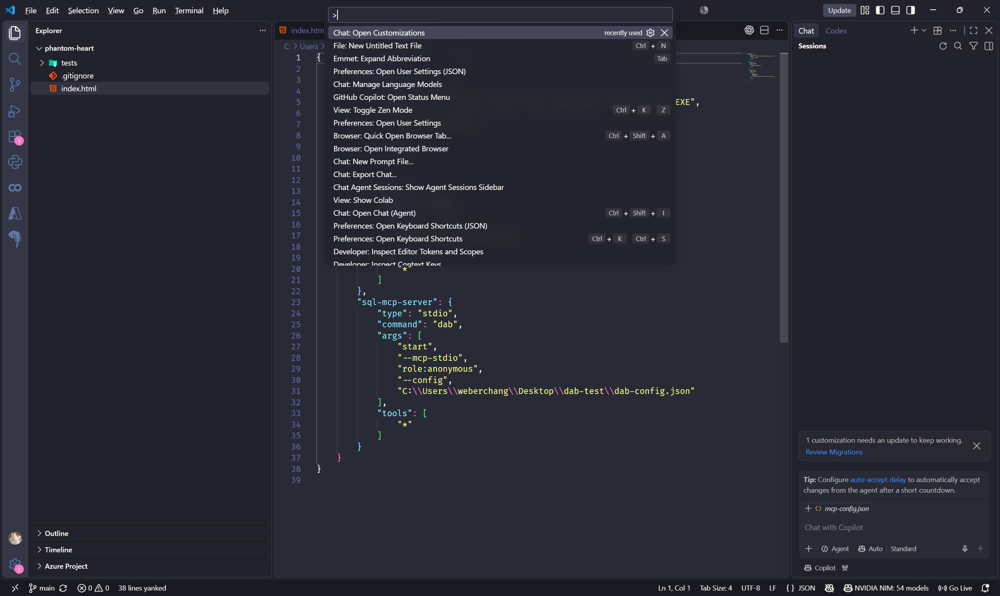
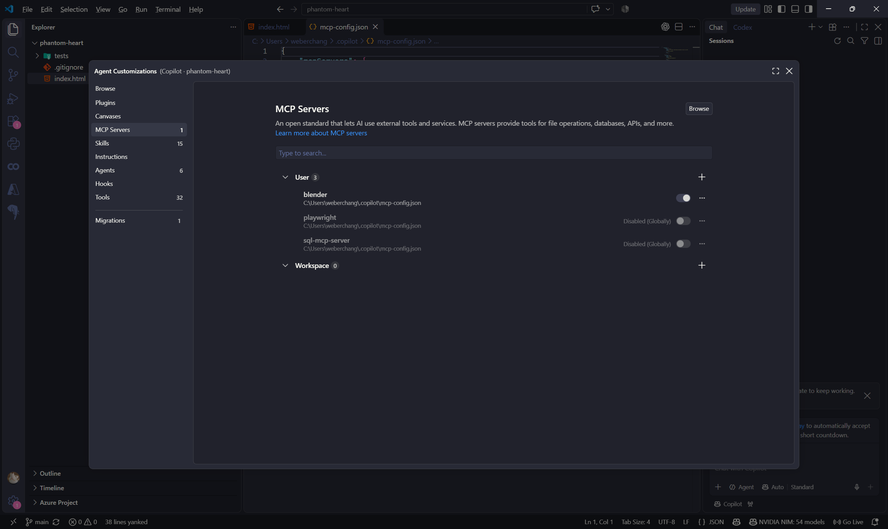
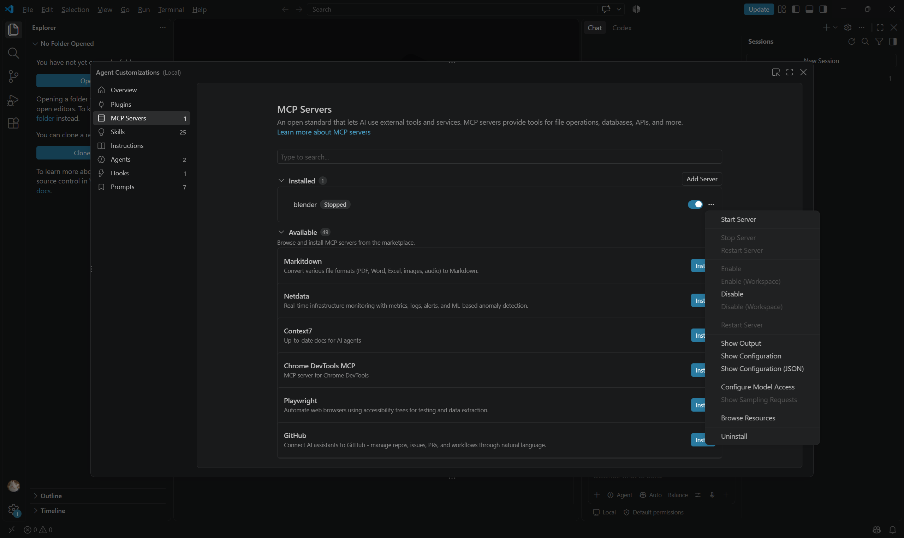
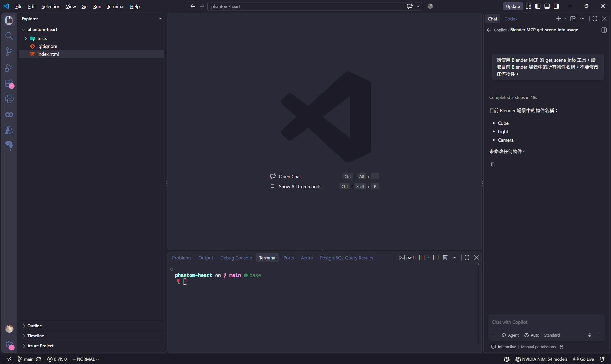
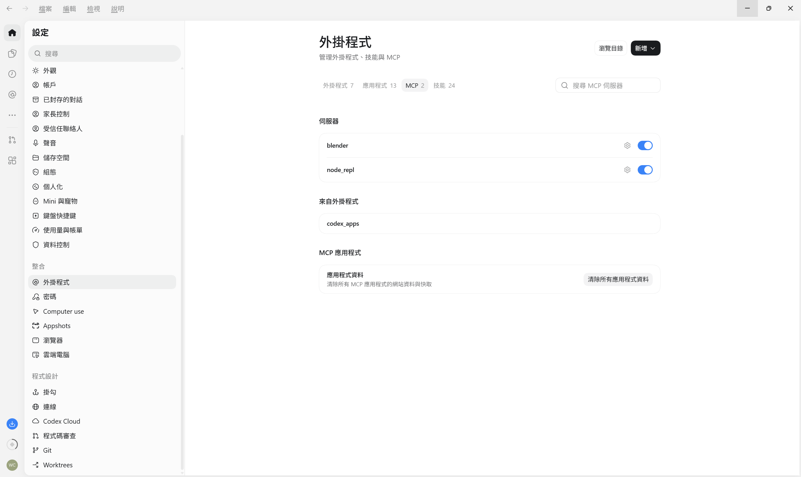
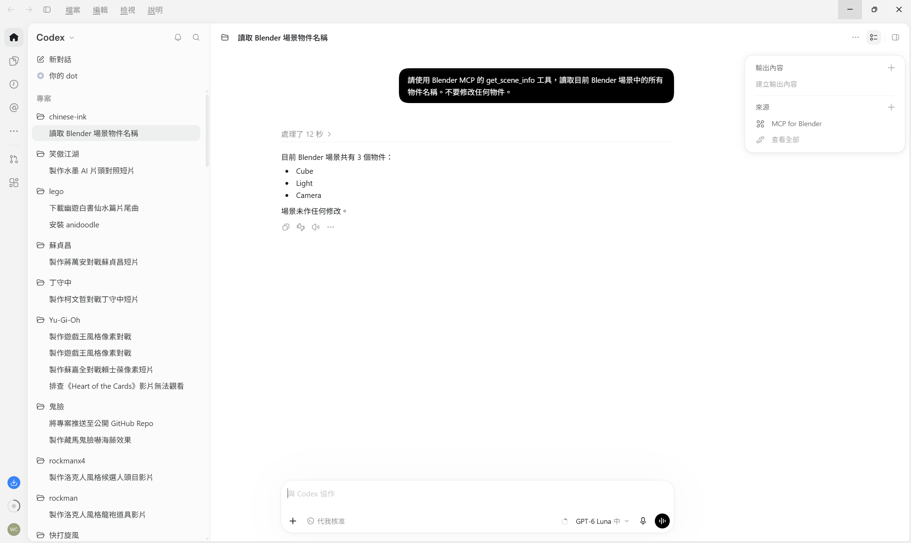

安裝 [blender](https://www.blender.org/)

安裝 [mcp server](https://github.com/ahujasid/mcp-for-blender)

windows
```
irm https://www.mcp-for-blender.com/install.ps1 | iex
```

mac/linux
```
curl -LsSf https://www.mcp-for-blender.com/install.sh | sh
```

開啟 vscode 按下 `ctrl + shift + p`

輸入 `Chat:Open Customization` 正常安裝即可看到 `blender`





接著打開 `blender` 這套軟體

codex 可以使用 `/mcp` 來看狀態, 他呼叫 mcp 通常使用自然語言沒有特定符號

copilot 則可以使用 `#` 來指令 mcp 這裡使用 `#blender` 即可

確認 mcp 是否啟動
```
請使用 Blender MCP 的 get_scene_info 工具，讀取目前 Blender 場景中的所有物件名稱。不要修改任何物件。
```



讓 codex 繪製紋理
```
使用 $imagegen 繪製寫實蘋果的紋理 我要給 blender 建模使用 要包含 uv 貼圖逼真的效果
```

呼叫 copilot 繪製蘋果模型並且套用 codex 繪製的紋理
```
#blender 繪製一個蘋果 並且套用 #file:apple_uv_texture.png
```

補充: 如果是 codex 要確認可以參考以下圖片



